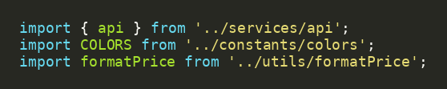
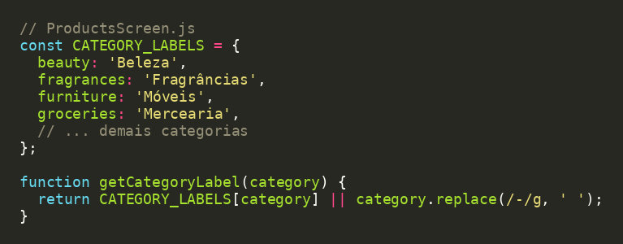
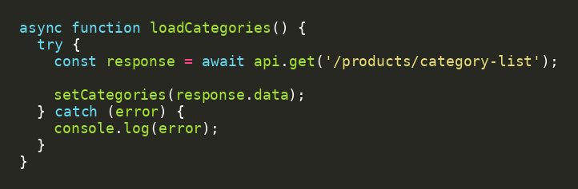
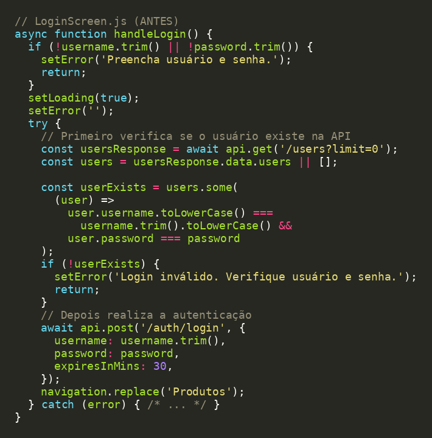
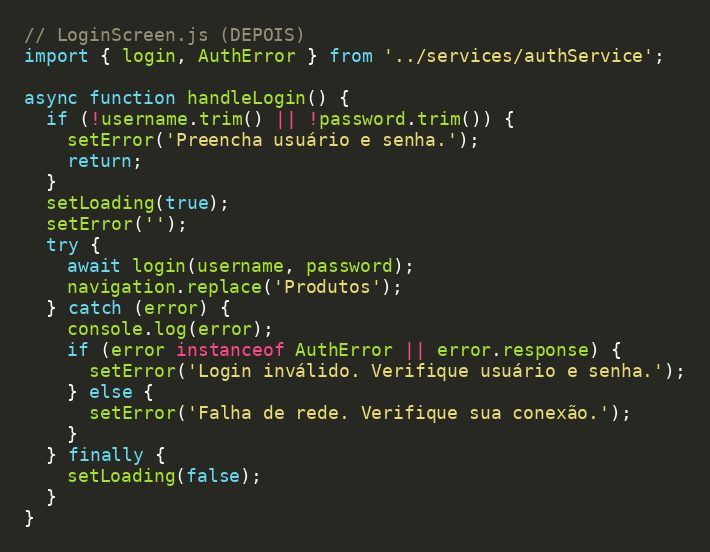
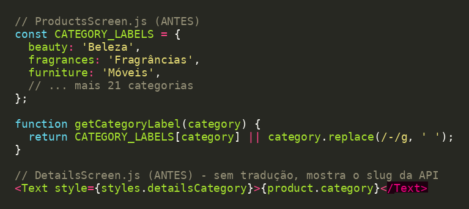
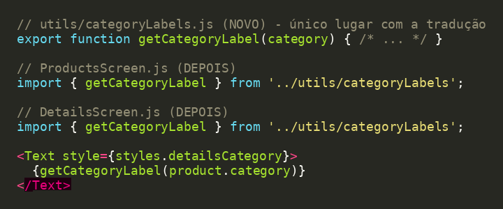

# Princípios SOLID – Trabalho G1 (React Native – Consumo de API)

## Integrantes

- Cristina Bisol Orso – RA 1139000
- Rafaela Laimer Davesc – RA 1138820

---

## Parte 1 – Boas práticas (SOLID) que já aplicamos

### 1. SRP – Single Responsibility Principle

**Por que se encaixa:** o SRP diz que um módulo deve ter um único motivo para mudar. No projeto, a comunicação com a API está em `services/`, a formatação de preço em `utils/formatPrice.js` e as cores em `constants/colors.js`. Cada arquivo cuida de uma coisa só, e a `ProductsScreen` apenas importa e usa esses módulos para montar a interface.

### 2. OCP – Open/Closed Principle

**Por que se encaixa:** o OCP diz que o código deve ser aberto para extensão e fechado para modificação. A tradução usa uma tabela (objeto) em vez de vários `if`/`switch`. Para suportar uma nova categoria basta **adicionar uma linha** na tabela, sem alterar a lógica de `getCategoryLabel`. Quando a categoria não está na tabela, há um comportamento padrão (`replace`), então nada quebra.

### 3. DIP – Dependency Inversion Principle (aplicado parcialmente)

**Por que se encaixa:** o DIP diz que módulos de alto nível não devem depender de detalhes de baixo nível. As telas não criam o Axios nem conhecem a URL base: dependem da instância `api` exportada por `services/api.js`. Trocar a URL, os headers ou a biblioteca HTTP afeta só esse arquivo. É uma aplicação parcial, pois as telas ainda conhecem os endpoints (veja a Parte 2).

> **Sobre L e I:** o LSP (Liskov) e o ISP (Interface Segregation) pressupõem herança e interfaces, que não aparecem neste projeto (componentes de função em JavaScript); por isso não foram usados.

---

## Parte 2 – Melhorias com SOLID

### Problema 1 – `LoginScreen` com responsabilidades demais (SRP + DIP)

**Antes:**

**Diagnóstico:** a tela cuida da interface (campos, loading, mensagens), da regra de autenticação (baixar usuários, comparar senha, decidir se é válido) e do acesso à API (endpoints e corpo da requisição). Isso viola o **SRP** (vários motivos para mudar) e gera **acoplamento** alto: a tela depende dos detalhes do `api` e do formato da resposta, ou seja, o módulo de alto nível depende de detalhes (**DIP**).

**Solução:** criar `services/authService.js` com `login(username, password)` e o erro `AuthError`. A tela passa a depender só dessa função, e a regra de autenticação fica em um único lugar. O comportamento do app é o mesmo.

**Depois:**

**Por que escolhemos:** é a função mais longa e com mais responsabilidades do projeto.

### Problema 2 – tradução de categorias dentro da `ProductsScreen` (SRP)

**Antes:**

**Diagnóstico:** a tabela e `getCategoryLabel` não têm relação com listar produtos, então a `ProductsScreen` passa a ter dois motivos para mudar (**SRP**): mudar a listagem e mudar as traduções. Por estar presa à tela, a `DetailsScreen` não reutiliza a tradução e mostra o slug em inglês (ex.: `mens-shirts`).

**Solução:** mover para `utils/categoryLabels.js`, com um único `getCategoryLabel` usado pelas duas telas. Adicionar ou corrigir uma categoria passa a ser feito em um só lugar (e mantém o **OCP** da tabela).

**Depois:**

**Por que escolhemos:** além de separar responsabilidades, corrige um comportamento visível ao usuário.
